# LampeOnline — BO Creation 💡

<div align="center">
  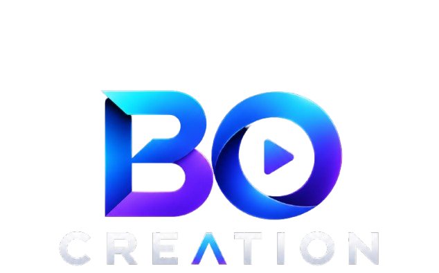
  <p><strong>Plateforme E-Commerce Haut de Gamme de Luminaires & Lampes Connectées en Tunisie</strong></p>
  <p>Showroom interactif 3D, personnalisation de température lumineuse en temps réel (Kelvin), synchronisation multi-appareils et administration complète.</p>
</div>

---

## 📸 Aperçu & Galerie de Captures d'Écran

### 1. Showroom & Page d'Accueil Interactive
Hero interactif avec lampe 3D réactive au curseur de souris, interrupteur d'allumage en temps réel, sélection par catégorie et luminaires vedettes dans une ambiance d'atelier feutré.
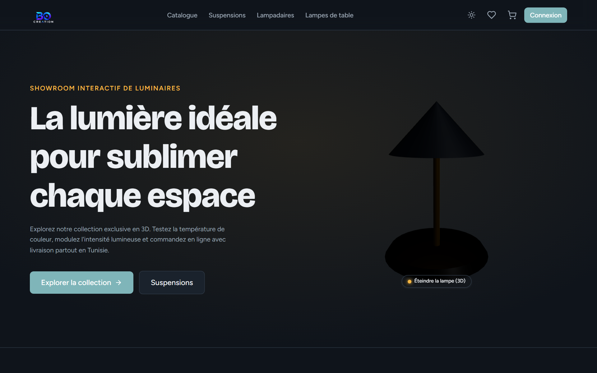

---

### 2. Catalogue de Luminaires avec Filtres & Cartes 3D Tilt
Filtrage instantané par catégorie, recherche textuelle, plage de prix en dinars tunisiens (TND) et tri. Les cartes produits réagissent à la souris avec un effet d'inclinaison 3D (tilt) et intégration directe des coups de cœur (wishlist).
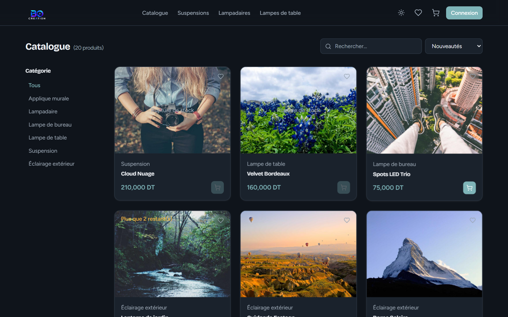

---

### 3. Fiche Produit & Visualiseur 3D Haute Fidélité
Visualiseur 3D temps réel (Three.js / React Three Fiber / Drei) avec contrôle d'orbite à 360°, allumage de l'ampoule, et potentiomètre de température de couleur (2700K chaud à 6500K lumière du jour) calculé par formule de corps noir physique.
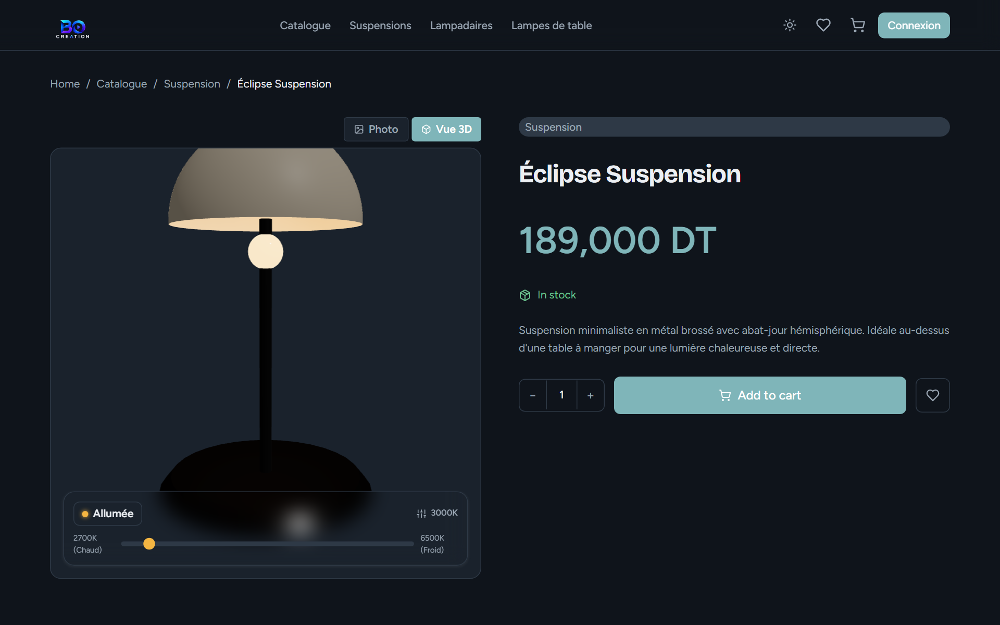

---

### 4. Panier Latéral Glissant (Cart Slide-over Drawer)
Panier réactif accessible en un clic depuis la barre de navigation. Ajustement des quantités, calcul automatique des sous-totaux en millimes et conservation locale avec synchronisation serveur automatique lors de la connexion.
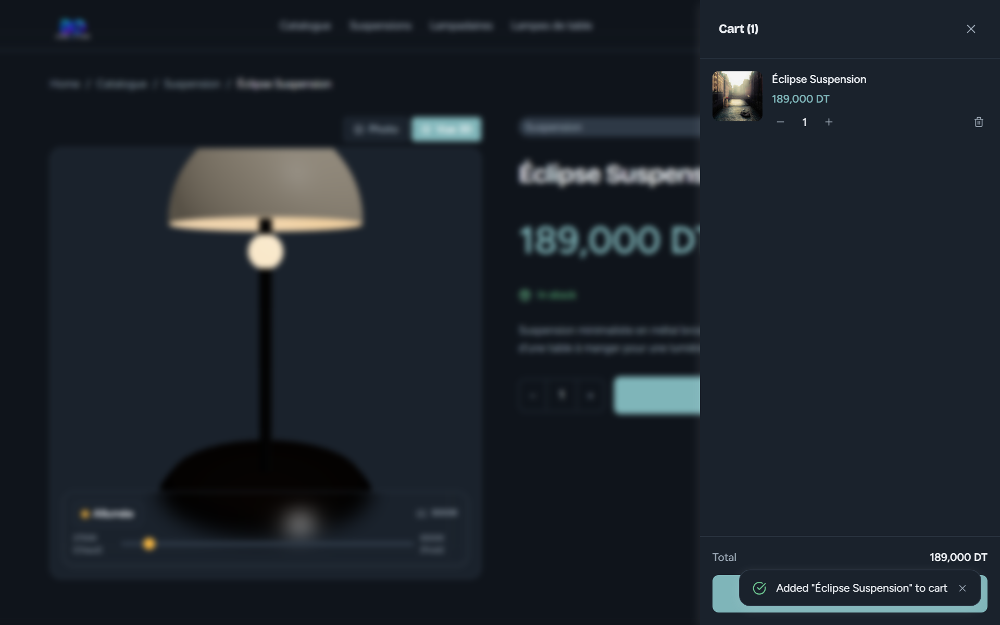

---

### 5. Tunnel de Commande & Simulateur de Paiement Sécurisé
Formulaire d'expédition pour la Tunisie (Gouvernorats, code postal, téléphone) et passerelle de paiement intégrée proposant le paiement à la livraison (Cash on Delivery) ou le simulateur de carte bancaire de test sans transit de données réelles.
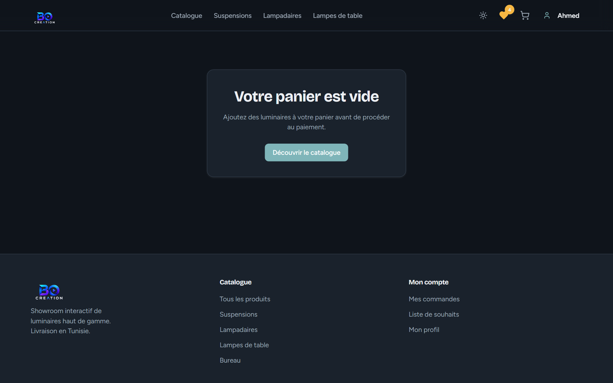

---

### 6. Espace Client : Liste de Souhaits ("Coups de Cœur")
Gestion synchronisée des luminaires favoris avec le backend. Ajout direct au panier, suppression instantanée et affichage du statut de stock en temps réel.
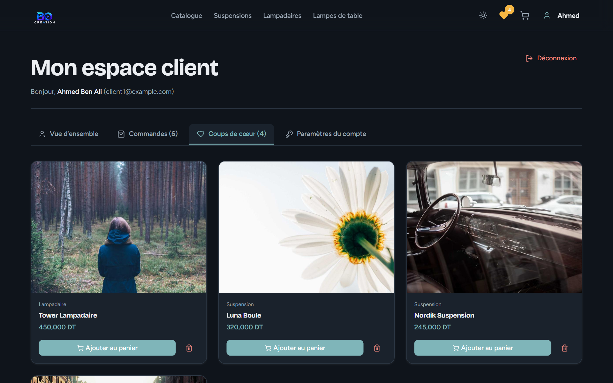

---

### 7. Espace Client : Historique & Suivi des Commandes
Consultation détaillée des commandes antérieures avec récapitulatif des articles achetés, numéro de référence, montants en TND et barre de progression du statut (`PENDING` → `PAID` → `SHIPPED` → `DELIVERED`).
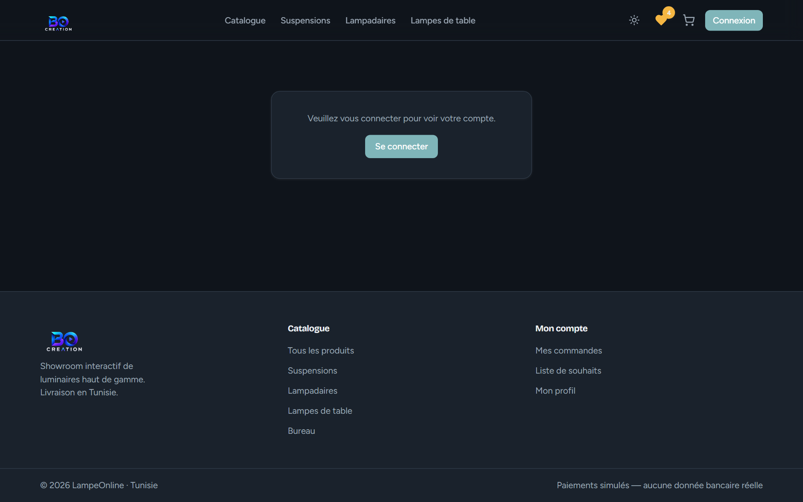

---

### 8. Panneau d'Administration : Tableau de Bord & Analytics
Statistiques en temps réel (chiffre d'affaires en TND, total des commandes, visiteurs uniques, taux de conversion) avec graphique à barres de fréquentation quotidienne (`dailyVisits`) et graphique du tunnel d'acquisition (`FunnelChart`).
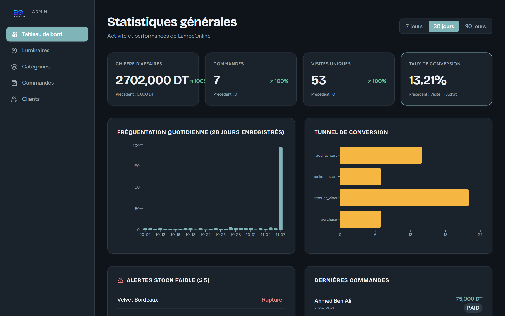

---

### 9. Administration : Gestion des Produits & Téléversement de Photos
Tiroir d'édition et de création de luminaires avec double modalité pour les images : téléversement direct de fichiers locaux (`/uploads`) ou ajout d'URL d'image avec prévisualisation en direct, ajustement des stocks et réglages 3D.
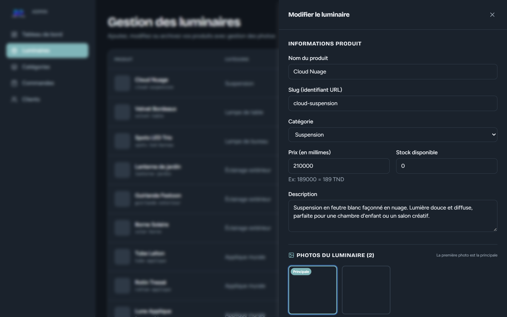

---

### 10. Administration : Gestion Complète des Catégories (CRUD)
Création, modification et suppression de catégories de luminaires avec vérification d'intégrité référentielle empêchant la suppression accidentelle de catégories associées à des produits actifs.
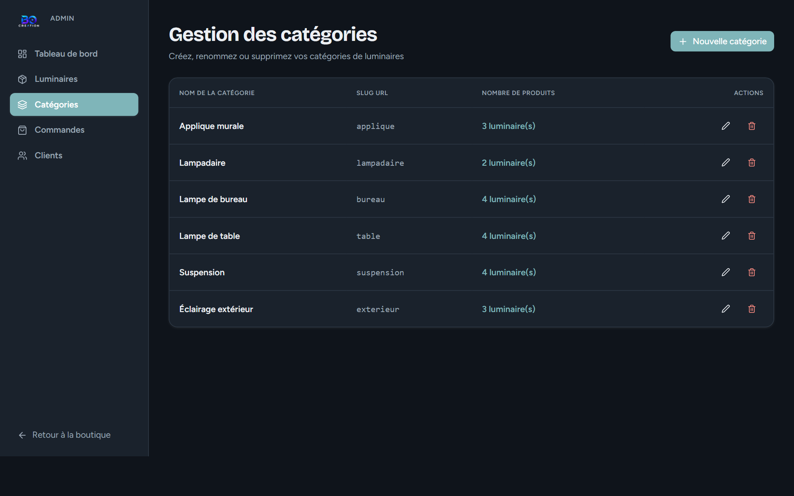

---

## 🏛️ Architecture & Conception Logicielle

Le projet est conçu sous la forme d'un **monorepo pnpm** strict, modulaire et hautement typé en TypeScript de bout en bout.

```
lampe_project/
├── apps/
│   ├── web/                    # Client SPA moderne (React 18 + Vite + Tailwind + R3F)
│   │   ├── src/
│   │   │   ├── components/     # UI tokens, 3D (HeroLamp, ProductViewer3D), layout, cart
│   │   │   ├── contexts/       # AuthContext, CartContext
│   │   │   ├── pages/          # Home, Catalog, Product, Checkout, Account, Admin, Auth
│   │   │   └── lib/            # Client API Fetch wrapper, utilitaires de devise
│   │   └── public/
│   │       └── assets/         # Logo BO Creation officiel & favicons
│   │
│   └── api/                    # Serveur REST Express + Prisma ORM
│       ├── prisma/
│       │   ├── schema.prisma   # Modélisation SQLite (PostgreSQL-ready)
│       │   └── seed.ts         # Seeder complet (admin, clients, 20 lampes, orders, analytics)
│       └── src/
│           ├── routes/         # Point d'entrée HTTP & middlewares de validation
│           ├── controllers/    # Déballage des requêtes & sérialisation des réponses
│           ├── services/       # Logique métier pure (paiements, stocks, analytics)
│           ├── repositories/   # Accès aux données Prisma découplé
│           └── middlewares/    # Auth JWT cookie, rôles (ADMIN/CLIENT), gestionnaire d'erreurs
│
├── packages/
│   └── shared/                 # Bibliothèque de schémas Zod & types TypeScript partagés
│       └── src/                # Auth, Products, Categories, Orders, Cart, Analytics
│
├── docs/                       # Spécifications de design, architecture et captures d'écran
├── scripts/                    # Scripts d'automatisation (captures d'écran Playwright)
├── pnpm-workspace.yaml
└── package.json
```

### 1. Modèle en Couches Backend
L'architecture de l'API suit scrupuleusement la règle des 4 couches :
1. **Routes (`routes/`)** : Définissent les endpoints HTTP, appliquent le rate-limiting, la vérification d'authentification (`requireAuth`), les rôles (`requireRole('ADMIN')`) et la validation Zod (`validateRequest(schema)`).
2. **Contrôleurs (`controllers/`)** : Reçoivent les paramètres validés, appellent les services correspondants et renvoient des réponses HTTP standardisées.
3. **Services (`services/`)** : Encapsulent les règles d'affaires (ex : vérification d'idempotence, contrôle de stock, simulation de paiement bancaire, hachage de mot de passe, fusion de panier).
4. **Dépôts (`repositories/`)** : Seule couche autorisée à interagir avec Prisma ORM et la base de données.

### 2. Gestion Précise de la Monnaie (Dinar Tunisien)
- En Tunisie, 1 TND correspond à **1000 millimes** (3 décimales).
- Pour éliminer tout problème d'arrondi ou d'imprécision des nombres flottants IEEE 754, **tous les montants sont stockés sous forme d'entiers stricts en millimes** (`priceMillimes`, `totalMillimes`).
- Les prix affichés sont formatés côté client via la fonction `formatTND(millimes)` : `189000 millimes` $\rightarrow$ `189,000 TND`.
- Les totaux de commandes sont **strictement recalculés sur le serveur** à partir des prix en base de données, jamais à partir du corps de la requête client.

### 3. Sécurité & Authentification
- **Mots de passe** : Chiffrés avec **Argon2id** (ou bcrypt cost 12+).
- **Sessions & JWT** : Jetons d'accès et de rafraîchissement stockés dans des **cookies httpOnly, Secure, SameSite=Lax** pour prévenir les attaques XSS et le vol de session.
- **Autorisation côté serveur** : Chaque route vérifie les rôles et la propriété de la ressource. Un client ne peut consulter que ses propres commandes, paniers et listes de souhaits.
- **Protection des paiements** : Aucune donnée de carte bancaire réelle n'est collectée ou journalisée. Le simulateur traite uniquement les cartes de test prédéfinies.
- **Upload de fichiers sécurisé** : Liste blanche de types MIME (`image/jpeg`, `image/png`, `image/webp`), limite de taille (5 Mo) et génération de noms uniques avec `crypto.randomUUID()`.

---

## 🎨 Système de Design & Identité Visuelle

Le design s'appuie sur le guide **Showroom Nocturne (Dusk Atelier)** :
> *"Tout reste calme et sobre, seule la lumière s'exprime avec audace."*

### 1. Variables & Jetons Sémantiques (Tokens CSS)
Aucune couleur hexadécimale arbitraire n'est codée en dur dans les composants. L'interface utilise exclusivement les variables CSS définies dans `index.css` :
- `--bg` : Teinte d'arrière-plan principale (mode nuit feutré ou jour épuré).
- `--surface` : Fond de carte et panneaux avec bordures subtiles (`--line`).
- `--ink` : Typographie principale à contraste élevé.
- `--mute` : Typographie secondaire et labels discrets.
- `--teal` : Couleur d'accentuation technique et signatures interactives.
- `--bulb` : Lueur chaleureuse symbolisant l'allumage des luminaires.

### 2. Rendu 3D & Moteur d'Éclairage
- **Bibliothèque** : React Three Fiber (R3F) et Three.js.
- **Modélisation procédurale** : Suspensions, lampadaires, lampes de table et appliques murales avec matériaux physiques (PBR standard materials, métaux brossés, bois scandinave, verre soufflé translucide).
- **Contrôle de Température de Couleur (Kelvin)** :
  L'application convertit dynamiquement la température Kelvin (2700K à 6500K) en coordonnées chromatiques RGB réelles pour une illumination ultra-réaliste dans le visualiseur.

---

## ⚡ Guide de Démarrage Rapide

### 1. Prérequis
- **Node.js** : version 20 ou supérieure (recommandé v22+)
- **pnpm** : version 9 ou supérieure

### 2. Installation
Clonez le dépôt et installez les dépendances :
```bash
git clone https://github.com/votre-compte/lampe_project.git
cd lampe_project
pnpm install
```

### 3. Configuration des Variables d'Environnement
Copiez le modèle `.env.example` dans `apps/api/.env` :
```env
PORT=4000
NODE_ENV=development
DATABASE_URL="file:./dev.db"
JWT_SECRET="lampe-online-super-secret-key-32chars-min!"
JWT_EXPIRES_IN="15m"
REFRESH_TOKEN_SECRET="lampe-online-refresh-token-secret-key!"
REFRESH_TOKEN_EXPIRES_IN="7d"
CORS_ORIGIN="http://localhost:5173"
ADMIN_EMAIL="admin@lampeonline.tn"
ADMIN_PASSWORD="Admin@123456"
```

### 4. Base de Données & Données Initiales (Seed)
```bash
# Générer le client Prisma et créer les tables SQLite
pnpm --filter api exec prisma db push

# Charger les luminaires, catégories, commandes et événements d'analytics
pnpm db:seed
```

### 5. Lancement des Serveurs de Développement
```bash
pnpm dev
```
- **Application Web** : [http://localhost:5173](http://localhost:5173)
- **API REST** : [http://localhost:4000](http://localhost:4000)

---

## 🔐 Identifiants de Test

| Rôle | Adresse Email | Mot de passe | Description |
|---|---|---|---|
| **Administrateur** | `admin@lampeonline.tn` | `Admin@123456` | Accès complet au dashboard, catalogue, commandes & clients |
| **Client Démo 1** | `client1@example.com` | `Client@123456` | Client actif avec commandes existantes et coups de cœur |
| **Client Démo 2** | `client2@example.com` | `Client@123456` | Client standard |
| **Client Bloqué** | `client3@example.com` | `Client@123456` | Compte suspendu pour démonstration du contrôle d'accès |

---

## 💳 Numéros de Cartes de Test (Paiement Simulé)

| Numéro de carte | Date d'expiration | CVV | Résultat de la transaction |
|---|---|---|---|
| `4242 4242 4242 4242` | Tout futur (ex: `12/28`) | `123` | **Succès immédiat** (Commande validée et payée) |
| `4000 0000 0000 0002` | Tout futur | `123` | **Refus immédiat** (Erreur de paiement simulée) |
| `4000 0000 0000 3220` | Tout futur | `123` | **Vérification 3DS simulée** (3 secondes d'attente puis succès) |

---

## 🧪 Qualité & Tests Automatisés

Le projet comprend une suite complète de tests unitaires, d'intégration et de validation statique :

```bash
# 1. Vérification des types TypeScript stricts (Monorepo complet)
pnpm typecheck

# 2. Exécution des tests unitaires & intégration (Vitest + Supertest)
pnpm test

# 3. Compilation et vérification des builds de production
pnpm build
```

---

## 👥 Licence & Crédits
Projet réalisé pour la boutique **BO Creation** — Tous droits réservés.
Conçu avec passion pour l'excellence du luminaire et l'artisanat du design d'intérieur en Tunisie.
